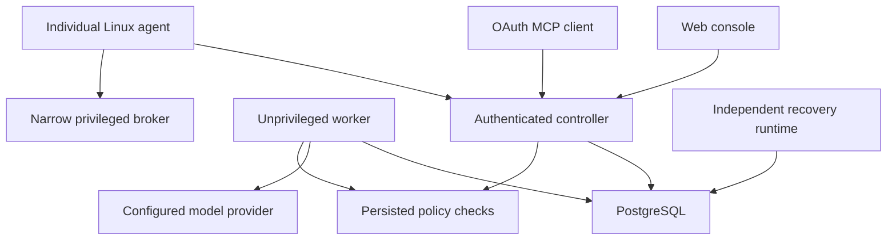
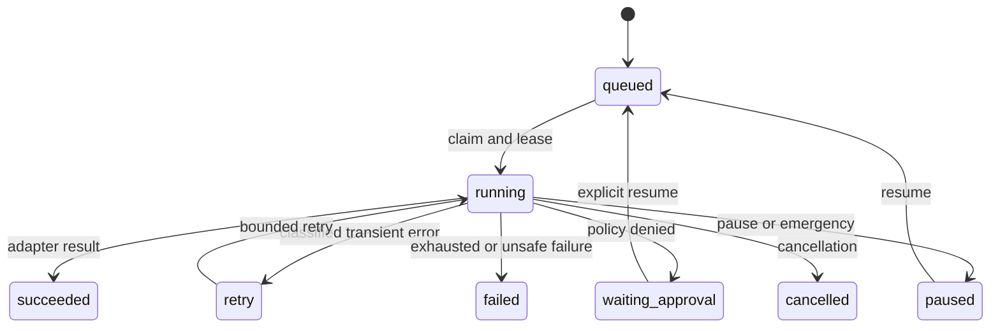

# Architecture

The controller is a native Python/FastAPI application. PostgreSQL stores identities, expiring policies, jobs, dependency links, checkpoints, execution events, inventory, graph edges, metrics, findings, incidents, memory, schedules and OAuth grants. The React client uses authenticated REST endpoints and SSE invalidation. Closing the browser has no effect on workers or native agents.

## Control plane and privilege boundaries

The API service is a trusted policy writer following authenticated owner requests. The worker can read policy and identities but cannot write accounts, policies, session credentials, emergency state or backup records. OAuth tables are inaccessible to it. Audit has PostgreSQL UPDATE/DELETE rejection triggers, and service roles cannot truncate it. The API and worker cannot write installed code, operator configuration or protected backup/recovery directories under the native systemd profiles.

Agent identity is an independent high-entropy secret, stored hashed at the controller. One-use enrollment tokens expire and are consumed transactionally. All production communication requires certificate-verified HTTPS. Revocation rejects the identity and queued commands. No SSH credential is shared across nodes.

The agent has no root, sudo or Docker socket. A separate local broker uses Unix peer identity and a root-owned exact target allowlist. The broker can collect privileged inventory and run the implemented fixed service/container/registered-Compose/scanner operations. No arbitrary command or user-defined URL/Compose manifest reaches privileged execution. OS root, the controller API process and the database administrator remain trusted.

## Durable execution

Claims use `FOR UPDATE SKIP LOCKED` and a transaction advisory lock for global/per-host limits. Jobs run in supervised child processes with deadlines and renewable leases. Restart recovery reclaims expired leases. Workflows persist completed steps and stable per-step idempotency keys. The node's SQLite WAL journal prevents blind repetition of interrupted mutations. An ambiguous remote integration write is checkpointed and stops for reconciliation rather than being replayed as though nothing happened.

Interval schedules persist their next execution time. Missed periods coalesce to one run and an unfinished scheduled job blocks overlap. Each new job and each concrete tool call is authorized again; schedules never renew grants. systemd separately schedules protected database backups and independent rollback checks.

## Observations and learning

Inventory collection records OS, packages, interfaces, addresses, routes, DNS, listeners, services, resource use, Docker objects and configuration evidence where accessible. Collection errors remain in the record. Graph edges distinguish direct observations/configured dependency labels from inferred reverse-proxy relationships. A wildcard listener is never treated as proof of internet exposure.

Reports produce metric samples, threshold and historical-median incident observations, configuration findings and operational memory. Memory records evidence and whether an outcome was verified. Retrieval is structured SQL text search, not vector learning or model fine-tuning. Eight specialists are permission-neutral instruction/model-routing configurations within one durable tool loop.

Configured monitoring jobs can perform allowlisted restarts, refresh inventory and verify observed health. There is no universal root-cause solver, invisible self-modification, automatic firewall editing or deletion of unexplained services. Development workflows produce tested Git candidates; generic live production application deployment remains unavailable.
