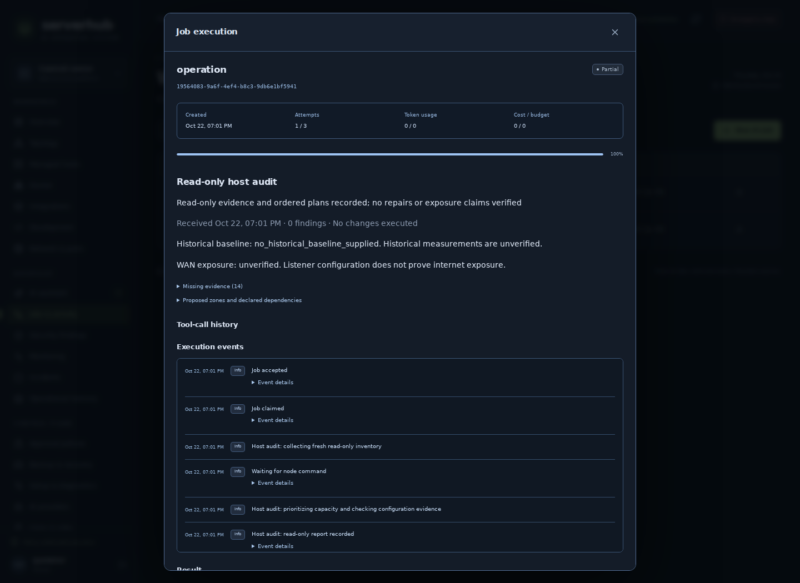
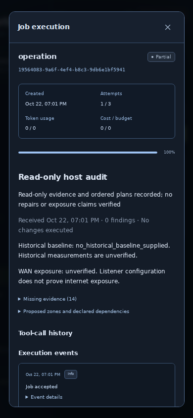

# Host audit increment verification

Implements the read-only workflow/reporting part of issues #3 and #2 on top of
PR #4. This is not a completed optimization or multi-agent system. No production
host, workload, firewall, credentials or database was modified; no PR was merged.

| Check | Result in isolated development environment |
| --- | --- |
| Full Python suite with disposable PostgreSQL 16.2 | **175 passed, 1 skipped**, 34.63 seconds |
| Optional skip | Real external Ollama endpoint/model not configured |
| Frontend tests | **30 passed** |
| TypeScript/Vite production build | Passed |
| Ruff: source, new audit tests, native CI script | Passed |
| Actual API/worker under separate PostgreSQL roles | Healthy startup; persistent read-only audit reached explicit `partial` with sample evidence, zero model tokens, zero writes |
| Existing durable workflow/audit chain | Two node inventory commands succeeded; audit chain verified |
| Restart/failure injection | Committed collection survives transient analysis failure without repeating node scan |
| Authorization | Unauthorized audit rejected; missing named storage grant blocks before scan; OAuth read-only token cannot launch audit |
| Broker positive test | Actual read-only `du` on a disposable root-owned directory; file retained |
| Broker negative tests | Arbitrary path/target/extra arguments rejected before command execution |
| Native staging | Passed in isolated staging directory |
| Browser, actual disposable backend | Read-only audit, inventory history, persisted job result, login; no JavaScript errors |
| Mobile, 390px | Audit/history/chat without horizontal overflow |
| Actual fresh Ubuntu/systemd install and audit | See final PR GitHub `native-ubuntu` check; never inferred from staging |

Reproduce with the existing disposable PostgreSQL CI environment:

```sh
python -m pip install -e '.[test]'
# Configure only a disposable test PostgreSQL database as in .github/workflows/ci.yml
python -m pytest --junitxml=test-results/backend.xml
python -m ruff check src/serverhub tests/test_host_audit.py scripts/test-native-ubuntu.py
npm --prefix frontend ci
npm --prefix frontend run build
npm --prefix frontend test -- --run
python -m serverhub.ops.installer --stage --root /tmp/serverhub-audit-stage --source .
```

The native Ubuntu CI script now also executes an adult's delegated read-only audit
through the real worker DB role and unprivileged node UID. Hosted non-root backend
runs skip the root-owned broker-target positive test; negative tests still run.
The local bundled PostgreSQL uses the previously documented test-only UID shim
for PostgreSQL binaries; this does not verify Linux service isolation locally.

The constrained Linux node reports genuine collection gaps. Screenshots display
its actual result with zero observed findings and missing evidence; they do not
substitute the operator's reported production baseline for live telemetry.





Limitations: actual production disk/mounts, NVIDIA drivers/runtime, SMART devices,
external Ollama, live Docker/Caddy/UniFi and restore readiness are unverified here.
The root-approved storage target may be incompatible with permissive NTFS
ownership; rejection is intentional. Existing grants are not automatically
expanded. Advanced baseline/scan arguments use REST/MCP generic submission rather
than the simple dashboard launch button. Findings are plans, not verified repairs;
all production changes still require separate authorization and implementation.
See [host-audit.md](host-audit.md) for exact behavior and safe rollout requirements.
